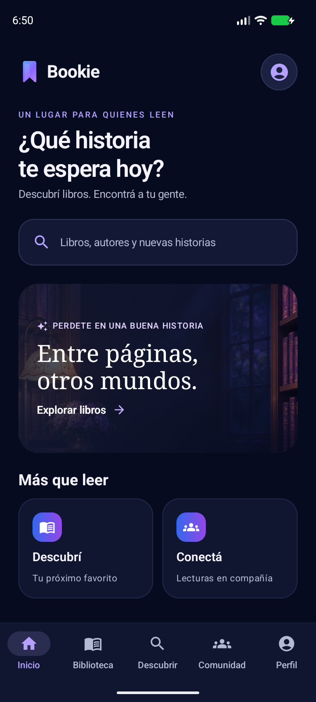
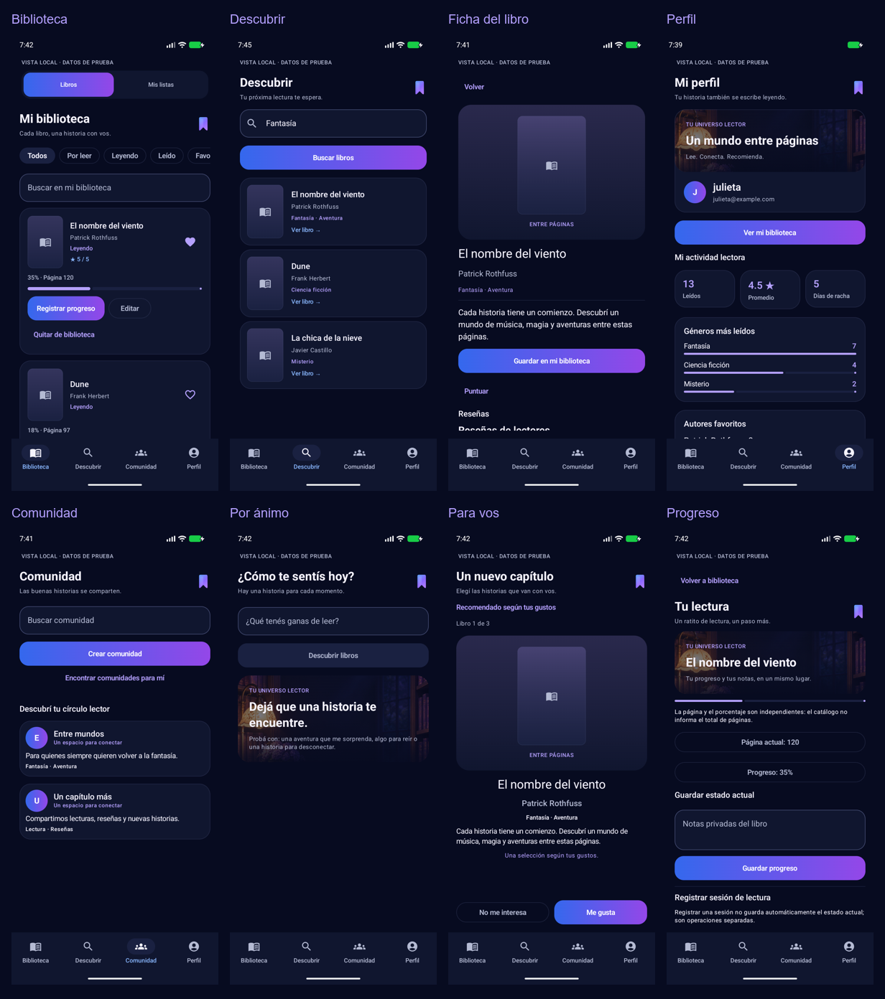
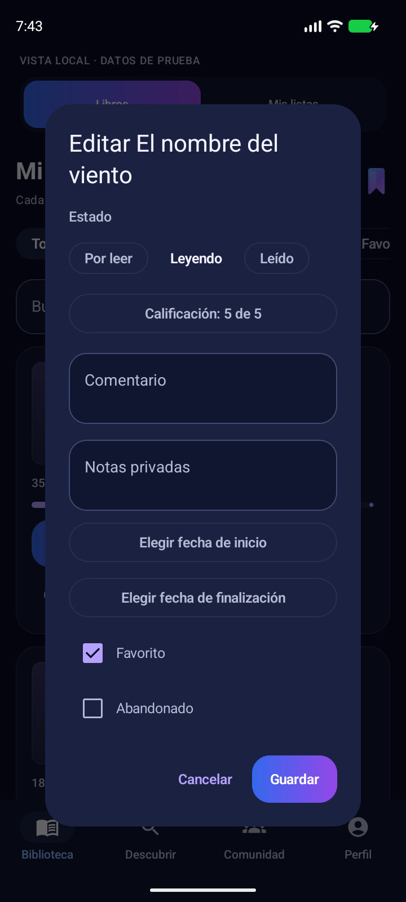
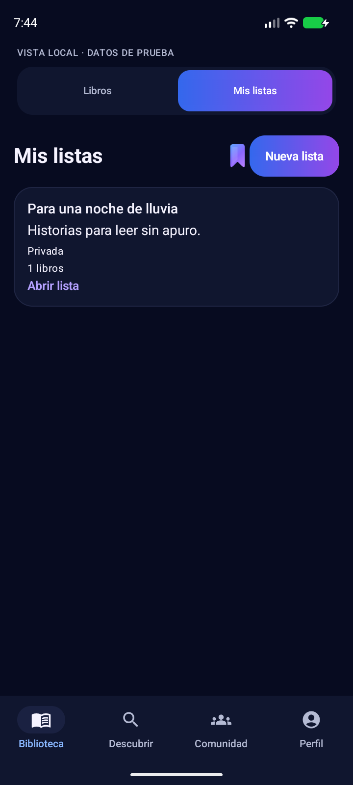

# Bookie night library design

## Scope

- Dark navy theme is now the default, with lavender text accents and blue-to-violet primary actions. The explicit light theme remains available through `BookieTheme(darkTheme = false)`.
- The shared startup screen reveals a native bookmark mark and the Bookie wordmark, then transitions into the application. It lasts approximately 1.4 seconds plus the transition; session restoration starts concurrently. Completion is saveable across Activity recreation.
- Android system startup and system bars use the same dark background, including the Android 12+ system splash icon.
- Home has a greeting, a discover entry point, an illustrated library feature, reading progress, real account recommendations and entry points into the existing features.
- The bottom bar exposes Inicio, Biblioteca, Descubrir, Comunidad and Perfil. Existing session checks remain in place.
- Sign-in, registration, loading, errors and email confirmation use the new visual language. Password fields still use `OutlinedSecureTextField`; switching modes clears both password fields. Submission and validation still run through the existing `AuthViewModel`.
- The same design now extends to the existing library, lists, catalog search, mood search, recommendation deck, book detail and reviews, community catalog/posts/comments, profile and reading statistics, preferences, reading progress, challenges, series and universes.

## Existing functionality carried into the remaining screens

The reference video was reviewed against the existing screen and ViewModel implementations. Its library filters/favorites, catalog search, recommendation choices, mood results, book detail/reviews and profile statistics are retained in the redesigned screens.

| Area | Presentation | Existing actions retained |
| --- | --- | --- |
| Library | Cover cards, status, favorite control and progress bar; rounded search and tabs | Filter by status/favorites, title/author search, pagination, refresh, edit, rating, comments, private notes, dates, abandoned state, removal confirmation, progress entry point |
| Lists | Shared tabs, collection cards and matching dialogs | Create/edit/delete lists, public/private visibility, search/add/remove books and pagination |
| Discover | Rounded section tabs, library artwork and compact result cards | Catalog search by title/author/ISBN, pagination/retry, personalized like/dislike feed, mood search and saving |
| Book detail | Cover hero, clear title/author/genre hierarchy, reader avatars and rating display | Save, rate, external links, reviews, sorting and pagination |
| Community | One scrollable catalog with recommendations, reader initials and dark cards | Search/create communities, recommendations, open/publish posts, comments/replies, compatibility and retries |
| Profile | Illustrated profile header, summary cards, genre/month bars and statistics panels | Reading statistics, preferences, library shortcut, session recovery and sign-out |
| Progress | Book banner, progress indicator and matching inputs | Current page/percentage, private notes, snapshot save, separate reading-session recording and session history |
| Preferences | Rounded fields and preference panels | Genres/authors, favorite-book selection, onboarding/edit/save/cancel and validation |
| Series and challenges | Matching headings, cards, section tabs and progress indicators | Universe filtering, series/universe detail, reading path/map, pagination, challenge participation and progress |

Shared primitives centralize headings, tabs, input styling, bordered panels, gradient actions, avatars, book presentations and summary metrics. Tabs expose their selected state and primary controls keep a minimum touch target. Catalog submission dismisses the keyboard; the application content accounts for keyboard insets. Covers keep a visible fallback while loading or if an image cannot be loaded.

## Data and navigation

No API endpoints, session storage or account configuration were changed. The home artwork is decorative; the reading and recommendation cards use existing ViewModel state. The design does not introduce invented book ratings, trends, notifications or social-login providers. Cached reading data retains its stale label. Series and challenge actions only appear when their runtime features are available.

The authentication UI is separated as `BookieAuthContent` so its states can be rendered without creating a session. Production `AuthScreen` supplies the existing ViewModel events and state. Preview form submission is not evidence of a successful Supabase login.

## Assets

`shared/src/commonMain/composeResources/drawable/bookie_library_night.png` is a library illustration generated for this change on 2026-11-26. It is bundled locally and does not require an image service or Internet access. The shared bookmark mark is drawn with Compose paths; the system splash has an Android vector version. User reference screenshots are not bundled in the application.

## Verification

Build and run the existing shared tests:

```sh
./gradlew :androidApp:assembleDebug :shared:testAndroidHostTest
```

The Windows verification uses the configured JDK 21 daemon and Android SDK 37.1. Android emulator review checks the home layout, navigation, splash and the authentication form with local state. Authentication requests and personalized content require the project's real runtime configuration and a real session; no credentials are committed.

iOS compilation and simulator checks require macOS and remain a separate validation step. All new product UI and the illustration live in `commonMain`.

### Recorded Android verification on 2026-11-26

- `:androidApp:assembleDebug`: successful. The final APK excludes the temporary visual-preview Activity.
- `:shared:testAndroidHostTest`: 240 tests across 57 suites, zero failures and zero skipped tests.
- Installed the final APK on the Android 37.1 emulator and observed the shared opening screen transition into Home.
- Reviewed the sign-in and four-field registration layouts using `BookieAuthContent` with local form state. Field focus and the visible local error state were also inspected. These previews did not create an account or contact Supabase.
- The emulator used its hardware keyboard configuration; a software-keyboard regression check remains separate from these screenshots.
- No real-session backend flow or iOS simulator run was performed in this Windows verification.

Actual emulator captures:

| Opening | Home |
| --- | --- |
|  |  |

| Sign-in with local form state | Registration with local form state |
| --- | --- |
|  |  |

### Delivery of the remaining screens

The remaining-screen changes are on `feat/bookie-night-library-redesign`; `main` is unchanged. No pull request or merge is created as part of this delivery.

Additional Android review used the production screen composables with isolated in-memory repositories. The temporary harness supplied local account/content fixtures and a reduced navigation footer; it was removed from source before the final APK build. Its sample books intentionally exercise the missing-cover fallback. These are rendering checks, not evidence of real account or backend operations.

- Reviewed library cards, catalog results, book detail, profile statistics, community catalog, mood discovery, recommendations and reading progress.
- Opened the library editor and inspected status, rating, comments, private notes, date controls and flags.
- Switched between library and lists using the new section tabs; inspected the loaded lists.
- Focused and submitted catalog search with its results retained. The emulator did not show the software IME, so a software-keyboard regression check remains pending.
- Android 37.1 System UI repeatedly stopped responding during review. Captures were repeated after dismissing its dialog; the temporary review Activity could display above the emulator lock screen. No Bookie crash appeared in the crash log. This is not a performance benchmark.
- The final product sources contain neither the harness nor its mock repositories, temporary Activity or sample account.



| Library editor | Lists |
| --- | --- |
|  |  |

The team runtime connection configuration was not available for this local build. The user requested that the changes be left ready on the branch. The real backend URL, Supabase URL and public client key still need to be supplied using the repository's existing local/environment configuration before testing with the team's accounts. No account credentials or replacement production endpoints are added.

### Descripción sugerida para el PR

Extiende el diseño nocturno de Bookie a las pantallas que conservaban el aspecto anterior: biblioteca, listas, descubrimiento, recomendaciones, búsqueda por ánimo, ficha y reseñas, comunidad, perfil, preferencias, progreso, sagas y retos. Unifica tarjetas, campos, pestañas y acciones con el inicio y el acceso ya rediseñados.

Conserva los ViewModels, las llamadas al backend y las operaciones existentes, incluidos favoritos, edición personal, paginación, comentarios, sesiones de lectura y manejo de errores. Mejora el desplazamiento del catálogo de comunidades y adapta el contenido al teclado.

Validación: compilación Android y 240 pruebas compartidas sin fallos. La conexión con cuentas reales requiere la configuración del equipo; la validación de iOS requiere macOS.
