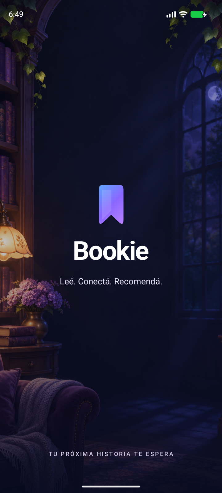
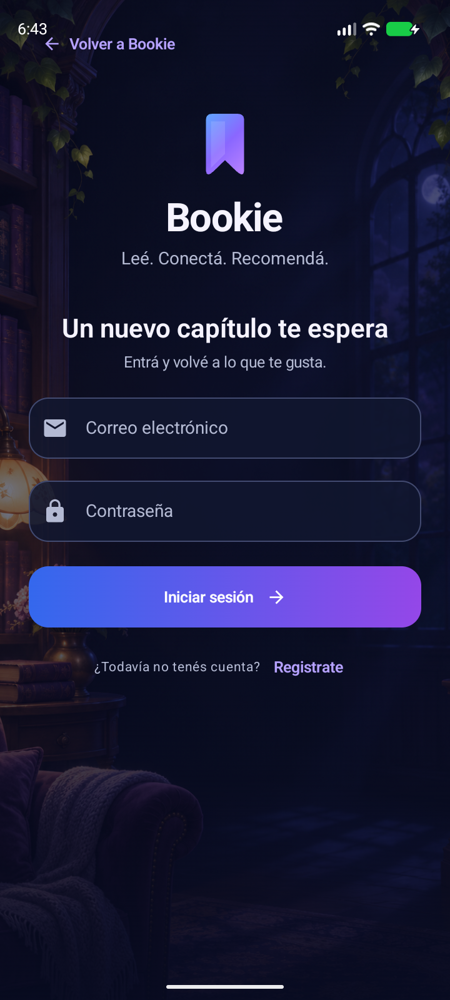
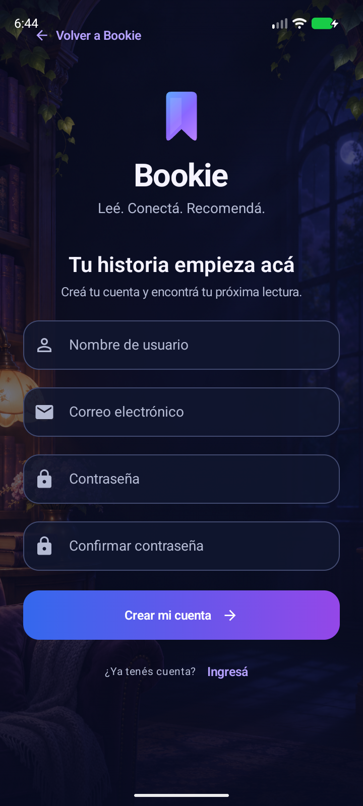

# Bookie night library design

## Scope

- Dark navy theme is now the default, with lavender text accents and blue-to-violet primary actions. The explicit light theme remains available through `BookieTheme(darkTheme = false)`.
- The shared startup screen reveals a native bookmark mark and the Bookie wordmark, then transitions into the application. It lasts approximately 1.4 seconds plus the transition; session restoration starts concurrently. Completion is saveable across Activity recreation.
- Android system startup and system bars use the same dark background, including the Android 12+ system splash icon.
- Home has a greeting, a discover entry point, an illustrated library feature, reading progress, real account recommendations and entry points into the existing features.
- The bottom bar exposes Inicio, Biblioteca, Descubrir, Comunidad and Perfil. Existing session checks remain in place.
- Sign-in, registration, loading, errors and email confirmation use the new visual language. Password fields still use `OutlinedSecureTextField`; switching modes clears both password fields. Submission and validation still run through the existing `AuthViewModel`.

## Data and navigation

No API endpoints, session storage or account configuration were changed. The home artwork is decorative; the reading and recommendation cards use existing ViewModel state. The design does not introduce invented book ratings, trends, notifications or social-login providers. Cached reading data retains its stale label. Series and challenge actions only appear when their runtime features are available.

The authentication UI is separated as `BookieAuthContent` so its states can be rendered without creating a session. Production `AuthScreen` supplies the existing ViewModel events and state. Preview form submission is not evidence of a successful Supabase login.

## Assets

`shared/src/commonMain/composeResources/drawable/bookie_library_night.png` is a library illustration generated for this change on 2026-11-26. It is bundled locally and does not require an image service or Internet access. The shared bookmark mark is drawn with Compose paths; the system splash has an Android vector version. User reference screenshots are not bundled in the application.

## Verification

Build and run the existing shared tests:

```sh
./gradlew :androidApp:assembleDebug :shared:testAndroidHostTest
```

The Windows verification uses the configured JDK 21 daemon and Android SDK 37.1. Android emulator review checks the home layout, navigation, splash and the authentication form with local state. Authentication requests and personalized content require the project's real runtime configuration and a real session; no credentials are committed.

iOS compilation and simulator checks require macOS and remain a separate validation step. All new product UI and the illustration live in `commonMain`.

### Recorded Android verification on 2026-11-26

- `:androidApp:assembleDebug`: successful. The final APK excludes the temporary visual-preview Activity.
- `:shared:testAndroidHostTest`: 240 tests across 57 suites, zero failures and zero skipped tests.
- Installed the final APK on the Android 37.1 emulator and observed the shared opening screen transition into Home.
- Reviewed the sign-in and four-field registration layouts using `BookieAuthContent` with local form state. Field focus and the visible local error state were also inspected. These previews did not create an account or contact Supabase.
- The emulator used its hardware keyboard configuration; a software-keyboard regression check remains separate from these screenshots.
- No real-session backend flow or iOS simulator run was performed in this Windows verification.

Actual emulator captures:

| Opening | Home |
| --- | --- |
|  |  |

| Sign-in with local form state | Registration with local form state |
| --- | --- |
|  |  |
